# Design Context Hub

An MCP server that turns scattered design and research repositories into **one token-aware knowledge layer** that designers, researchers and AI agents can query.

Design organizations that adopt AI tend to grow many local knowledge bases: a brand folder here, a research repository there, a design-system fork in one business unit. Each works on its own; none of them talk to each other, and agents end up quoting stale or conflicting guidance. This project is a small, working version of the layer that sits on top of them.

> Built as a portfolio project. The corpus is a fictional fintech ("Orbit"): 15 documents across 4 team repositories, with deliberate duplication and conflicts.

## What it does

- **Hybrid retrieval**: BM25 for exact terms (hex codes, product names like "Pix") + local embeddings for meaning ("folks quit when photographing their ID"), fused with Reciprocal Rank Fusion.
- **Authority-aware ranking**: canonical documents beat drafts and superseded versions. Stale results are not hidden; they come back with a warning that points to the canonical replacement.
- **Token budget**: every answer is packed under a `max_tokens` budget, with at most 2 chunks per document and a similarity floor so the context is not padded with noise.
- **Observability built in**: every tool call logs latency, tokens returned, budget utilization, cache hits and errors; `usage_stats` reports p50/p95 per tool.
- **Rate limiting**: a token bucket protects the server from runaway agent loops.
- **Evaluation**: 20 labelled questions measure hit@1, recall@3, MRR, context size and latency for keyword, semantic and hybrid retrieval.
- **Local and private**: embeddings run on CPU with `all-MiniLM-L6-v2`. No API key, and no document leaves the machine.

## Architecture

```mermaid
flowchart LR
  subgraph Repos["Team repositories"]
    A[brand-guidelines]
    B[research-insights]
    C[design-system]
    D[content-design]
  end
  Repos --> I["Ingest: frontmatter, section chunks with contextual headers, embeddings"]
  I --> X[(index.json)]
  Q[Agent or person] -->|MCP tool call| S[MCP server]
  S --> R["Retriever: BM25 + vectors → RRF → authority weight → similarity floor"]
  X --> R
  R --> P["Packer: token budget, max 2 chunks per doc"]
  P --> F["Cited context + staleness warnings"]
  F --> Q
  S --> M[(usage.jsonl metrics)]
```



## MCP tools

| Tool | Purpose |
| --- | --- |
| `search_design_knowledge` | Hybrid search across every repository. Returns cited context within `max_tokens` (default 1200), optionally filtered by `repo` or `kind`. |
| `get_document` | Full text of one document, flagged if superseded. |
| `list_sources` | Every document with owning unit, status and last update: the inventory needed to decide what becomes standard. |
| `usage_stats` | Calls, p50/p95 latency, tokens returned, budget utilization and cache hit rate per tool. |

Example: asking *"Which purple is our primary color?"* returns the canonical palette first (Orbit Violet `#6B2BD9`) and, further down, the 2024 palette with:

> Warning: superseded by `color-palette`. Prefer the canonical document.

## Evaluation

`npm run eval` runs 20 labelled questions over 15 documents (47 chunks) with an 800-token budget:

| Mode | Hit@1 | Recall@3 | MRR | Expected doc in context | Avg context tokens | p50 ms | p95 ms |
| --- | --- | --- | --- | --- | --- | --- | --- |
| bm25 | 85% | 90% | 0.88 | 90% | 221 | 0.1 | 0.5 |
| vector | 90% | 100% | 0.95 | 100% | 146 | 3.9 | 5.6 |
| hybrid | 90% | 100% | 0.95 | 100% | 227 | 3.6 | 5.1 |

What the numbers showed along the way:

- **Keyword search alone misses paraphrases** ("why do people give up during sign up?"). Adding embeddings took recall@3 from 90% to 100%.
- **Latency was misleading at first.** Hybrid search measured 0.2 ms because a query-embedding cache leaked between modes. Isolating the cache per mode gave the real ~4 ms.
- **Semantic search padded the context.** It always returned something, so irrelevant chunks filled the budget. A cosine floor of 0.3 cut hybrid context from ~280 to ~227 tokens per query without losing recall.
- **On this small corpus, hybrid and vector tie on aggregate.** Hybrid is kept because BM25 guarantees exact terms such as color codes and product names, which small embedding models handle poorly. A larger, messier corpus is the real test.

Full report and remaining misses: [`eval/RESULTS.md`](eval/RESULTS.md).

## Quick start

```bash
npm install
npm run ingest   # builds index/index.json (downloads the ~23 MB embedding model once)
npm run eval     # retrieval evaluation → eval/RESULTS.md
npm run smoke    # starts the MCP server over stdio and calls every tool like an agent would
```

### Use it from Claude Code

```bash
claude mcp add design-context-hub -- npx tsx /absolute/path/to/design-context-hub/src/server.ts
```

### Use it from Claude Desktop

```json
{
  "mcpServers": {
    "design-context-hub": {
      "command": "npx",
      "args": ["tsx", "/absolute/path/to/design-context-hub/src/server.ts"]
    }
  }
}
```

To use your own documents, point `CORPUS_DIR` to a folder with one sub-folder per repository and Markdown files with this frontmatter:

```yaml
---
title: Button component
kind: component        # guideline | research | component | content
unit: Design System    # owning team
status: canonical      # canonical | draft | superseded
updated: 2026-09-05
supersedes: button-lending-variant   # optional
---
```

## Project structure

```
corpus/            sample repositories (fictional)
src/server.ts      MCP server: tools, rate limiting, instrumentation
src/retrieve.ts    hybrid ranking, authority weighting, token packing, formatting
src/bm25.ts        Okapi BM25
src/embed.ts       local embeddings (transformers.js)
src/corpus.ts      frontmatter parsing and section chunking
src/metrics.ts     JSONL usage log and p50/p95 summary
eval/              labelled questions and results
scripts/           ingest, eval, smoke test
```

## Design decisions

- **MCP instead of a custom API**: any MCP client (Claude Code, Claude Desktop, IDE agents) can use the knowledge layer without integration work.
- **Return context, not answers**: the server retrieves and packs. The calling model writes the answer, so the hub stays cheap, model-agnostic and easy to evaluate.
- **Demote, don't delete**: superseded and draft documents still surface with warnings. Canonicalization is a human decision; the system makes conflicts visible.
- **Contextual chunk headers**: every chunk starts with document title, section and repository, so it still makes sense when retrieved alone.
- **Approximate token counts** (~4 characters per token): good enough for budgeting. Swap in the target model's tokenizer when exact counts matter.

## Next steps

- A cross-encoder reranker and a larger evaluation set.
- Incremental ingest from Git repositories and a scheduled freshness report.
- Exporting metrics to OpenTelemetry.

## Author

Willians de Oliveira Santana · [LinkedIn](https://www.linkedin.com/in/willians-santana-oliveira)

License: MIT
